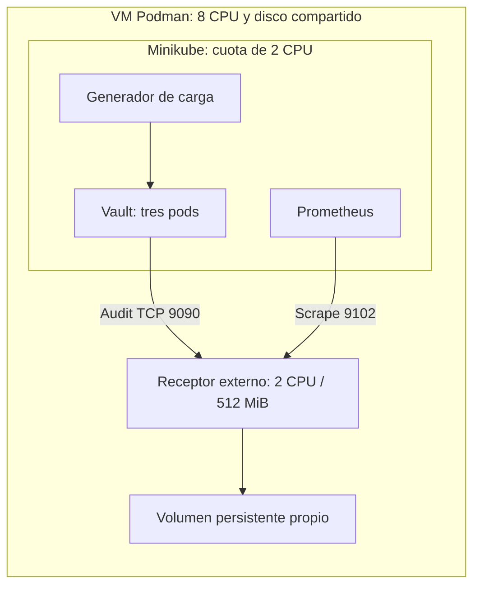

# Audit TCP fuera de Minikube

Esta batería extiende `10_Transit.ipynb` sin sustituir la serie histórica.

## Topología

- VM Podman: 8 CPU y 12 GiB RAM.
- Minikube workshop-k8s: cuota de 2 CPU, tres pods de Vault y generador.
- Receptor `vbb-tcp-external`: contenedor hermano, cuota de 2 CPU y 512 MiB, volumen `vbb-tcp-external-data`.
- Red privada Podman `workshop-k8s`; no se publican puertos en el Mac.
- TCP 9090 y métricas 9102; comprobar IP en `/tmp/vault/vbb-tcp-external/deployment.json`.
- Misma VM y disco físico: separa cuota CPU, no constituye otra máquina.



## Ejecución y reanudación

Desde Bash, con las credenciales locales existentes (no volcarlas al notebook):

```bash
set -a
source /tmp/vault/config.env
set +a
export VBB_STATE_DIR=/tmp/vault/vbb-tcp-external
export VBB_SUITE_ID=20261029-tcp-external
# Sólo en el primer despliegue; el receptor ya está desplegado:
# python3 vault-benchmark/telemetry/external_setup.py
python3 vault-benchmark/telemetry/external_suite.py
python3 vault-benchmark/telemetry/external_check.py
python3 vault-benchmark/telemetry/external_report.py
```

El setup se usa sólo para el primer despliegue. La batería reanuda casos no completados desde su manifiesto. Guarda el estado audit actual en una carpeta separada y lo restaura en `finally`; la autorización del usuario incluye suspender y recrear `scep-intune-validation/`, lo que cambia su clave HMAC.

## Diseño

50 casos: cinco escenarios por ocho tamaños, con tres repeticiones para batch 500. Escenarios: sin audit, file default, TCP default, file combinado y TCP combinado. Orden alternado. Combinado = exclusión de request.data + ciphertext/batch_results sin HMAC, conservando log_raw=false y plaintext de decrypt unitario con HMAC. La exención de batch_results también afectaría a un decrypt por lotes; este benchmark sólo descifra de forma unitaria.

Calentamiento inicial de 30 s; cada caso dura 60 s; 50 workers en unitario y 10 en batch; mezcla 95/5 de peticiones encrypt/decrypt y decrypt unitario. Batch 9000 contiene 8.982 elementos. Tasas de elementos y porcentajes se calculan frente a la línea base contemporánea del mismo tamaño. La mezcla de elementos depende del batch.

Los logs nuevos se escriben en subdirectorios por ejecución, fuera del patrón de rotación histórica. En la comparación controlada no se comprimen durante la carga; se verifican y se archivan con gzip al terminar cada caso, antes del siguiente. El rotador histórico se sigue midiendo y cualquier actividad debe marcarse.

## Integridad y persistencia

El receptor conserva los bytes en un fichero por conexión para evitar intercalar fragmentos de diferentes nodos. No descarta datos ni limita el tamaño de las líneas. Al cerrar una conexión ejecuta fsync. TCP no da un reconocimiento durable por evento a Vault; medir la recepción y el fichero final no sustituye pruebas de fallo.

La validación sintética comprueba round-trip, batch_results y HMAC/exclusiones antes de cada caso. Tras deshabilitar el dispositivo de prueba se espera el drenaje, se leen todos los logs, se deduplica por request.id y se comparan peticiones/elementos. En unitarios se conservan intervalos para el primer milisegundo cuando se mezcla preparación y carga. No se transmiten payloads durante la verificación: sólo identificadores, contadores y errores.

## Telemetría

Prometheus mantiene los 10 targets anteriores y añade el receptor externo. Exporta cgroup CPU/cuota/throttle, RAM, PSI, IO por dispositivo, bytes/entradas, errores y compresión. `telemetry.json` conserva PromQL y series; se resumen desde inicio + 20 s hasta fin. Memoria actual incluye page cache y no equivale a heap/RSS. Los IO del receptor se atribuyen a su cgroup; el disco virtual global se comparte. El receptor no parsea JSON durante la carga: la contabilización semántica es posterior y su CPU no está incluida en la del receptor durante el benchmark.

## Diagnósticos posteriores

`external_finalize.sh` se ejecuta únicamente cuando la matriz principal ha terminado y restaurado el audit. Comprueba los 50 casos, ejecuta dos casos adicionales de batch 500 combinado con compresión, prueba la parada/recuperación del receptor y verifica otra vez la restauración.

- Fichero: logrotate cada 2 s, umbral de 64 MiB, gzip y delaycompress, señal HUP al proceso exacto de Vault. Sólo actúa sobre el subdirectorio de esa ejecución.
- TCP: rotación en límites de líneas completas, umbral de 64 MiB y gzip en el receptor externo.
- Las políticas de compresión no son idénticas. Son diagnósticos separados de la matriz sin compresión, no una comparación de dos colectores equivalentes.
- Interrupción: 10 peticiones antes, 3 intentos con el receptor parado y 10 tras recuperarlo. Se contrastan las respuestas HTTP satisfactorias con los IDs conservados en el audit. No simula un corte de alimentación de la VM.
- Se repite esperando 15 s antes de las fases de indisponibilidad y recuperación; `external_reconnect.py` comprueba después la entrega al recrear el dispositivo, diferenciándola de la reconexión automática.
- Al finalizar se entrega una variante del receptor con nombres únicos entre reinicios. Las imágenes medidas y entregadas, así como la verificación de conservación de logs tras reiniciar, quedan identificadas en `20261029-tcp-external-delivery-verification.json`.

No lanzar dos suites simultáneas. Los manifiestos permiten reanudar sin repetir los casos completados. Para una batería nueva, usar otro `VBB_SUITE_ID`; no borrar los manifiestos existentes. El notebook y el resumen separan siempre las series.

## Configuración TCP empleada

El controlador de pruebas aplica y restaura esta configuración; no hace falta ejecutarla manualmente para consultar los resultados:

```bash
vault audit enable \
  -local \
  -path=vbb \
  socket \
  address=192.168.58.4:9090 \
  socket_type=tcp \
  write_timeout=2s \
  log_raw=false
```

En el combinado añade `exclude='[{"condition":"\"/request/mount_type\" == transit","fields":["/request/data"]}]'` y configura las claves no HMAC `ciphertext` y `batch_results` en `transit/`. El receptor se deja disponible para inspección, pero al terminar no queda conectado al audit de Vault: se restaura el dispositivo original.

## Resultado de la entrega del 29/10/2026

50 casos principales y dos de compresión completados, con telemetría y conteo verificados. Los resultados y limitaciones están en `../runs/20261029-tcp-external-summary.md` y en el apartado final de `10_Transit.ipynb`.

La prueba de interrupción mostró respuestas HTTP 200 sin las correspondientes respuestas en el audit, también después de arrancar el receptor y esperar 15 s. El control positivo al recrear el dispositivo volvió a registrar encrypt/decrypt. Por tanto, el receptor entregado no queda validado como único destino de auditoría frente a fallos. Se conservan las evidencias de ambas interrupciones, el control positivo y la restauración del audit original.

Un contador de fallo de audit de la matriz incluye dos eventos de `sys/metrics` durante la habilitación del dispositivo, antes de la carga. `external_backfill.py` añade la ventana de 20 s usada para distinguir preparación y medición, conservando la métrica original de 60 s. El caso incluye el log operativo y `audit-failure-review.json`.

## Fuentes

- https://developer.hashicorp.com/vault/docs/audit/socket
- https://developer.hashicorp.com/vault/docs/audit
